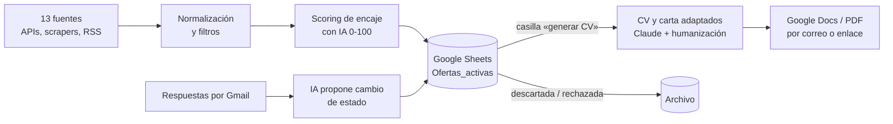

# Jobs

Pipeline personal de búsqueda de empleo cualificado en remoto, construido con **n8n**, **Google Sheets** e IA. Rastrea ofertas en una docena de portales, las filtra, puntúa su encaje con el perfil de la candidata, adapta el CV y la carta a cada oferta y sigue las respuestas de las empresas.

*English: a personal job-hunting pipeline built with n8n, Google Sheets and LLMs. It scrapes remote job boards, filters and scores listings against a profile, tailors the CV and cover letter per offer, and tracks employer replies. It is a single-user tool, not a product.*

> Herramienta de **una sola persona**: su autora. Los datos reales (CV, perfil, hoja de cálculo, credenciales) no se publican; ver [`data/examples/`](data/examples/).

## Qué hace



1. **Ingesta** (dos veces al día): recoge ofertas, descarta las no remotas, las de salario bajo, las que no encajan con el perfil y las repetidas (por id y por URL), y las puntúa. Si una fuente falla, las demás siguen y llega un aviso.
2. **Revisión**: la hoja es la interfaz. Cada oferta trae un encaje de 0 a 100 con su motivo en una frase.
3. **CV y carta**: para cada oferta marcada, la IA adapta ambos documentos **en el idioma de la oferta**, sin inventar experiencia, y retoca el estilo para que no suene a plantilla.
4. **Seguimiento**: la IA lee las respuestas de las empresas y **propone** un cambio de estado; la persona valida.
5. **Archivado**: las candidaturas cerradas pasan al archivo al instante (Apps Script `onEdit`).

## Stack

| Capa | Herramienta |
|---|---|
| Orquestación | n8n (4 workflows: ingesta, generación CV, seguimiento, archivado) |
| Datos / interfaz | Google Sheets + Apps Script |
| Scraping | Apify, APIs públicas y RSS |
| IA | Claude (adaptación de CV y carta, seguimiento), OpenAI `gpt-4.1-mini` (humanización del estilo) |
| Documentos y correo | Google Docs, Drive y Gmail |

## Decisiones y enseñanzas

- **La hoja de cálculo es base de datos e interfaz a la vez**: cero código de front, cero cuentas, adecuado para una sola usuaria.
- **Agentes donde aportan, flujos deterministas donde no.** La IA puntúa, redacta y propone; los filtros y el dedup son reglas medibles.
- **Se mide el embudo**: una pestaña `Metricas` cuadra, fuente a fuente, lo que entra y lo que se descarta. De unas 248 ofertas, unas 15 superan los filtros básicos.
- **La IA propone, la persona decide**: el estado de una candidatura nunca cambia sola.
- Límites explícitos: no hay sistema de evals todavía ni prueba con otros usuarios; el case study lo dice sin rellenar con cifras inventadas.

## Documentación

Empieza por el **[case study](docs/case-study.md)** y el [índice de docs](docs/index.md). Incluye la [especificación funcional](docs/04-spec.md), la [revisión legal (AI Act y RGPD)](docs/03-legal.md) y la referencia de cada workflow.

## Estructura

```
docs/            documentación y case study
apps-script/     Apps Script de mantenimiento de la hoja (clasp)
data/examples/   datos de ejemplo ficticios (el perfil real no se publica)
```

## Licencia

[MIT](LICENSE)
